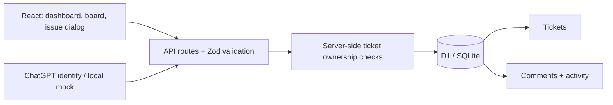

# CampusDesk

A campus issue tracker built as a third-year portfolio project.

## Features

- Sign in through ChatGPT to access a personal workspace.
- Create tickets with validated titles, descriptions, locations, categories and priorities.
- Search and filter tickets, with newest, oldest and priority-first sorting.
- Switch between a table and a responsive three-column issue board.
- Add persistent comments and inspect a chronological activity timeline.
- Record ticket creation and status/assignment updates atomically with authenticated author identities.
- Use the admin demo view to assign tickets and move them through Open, In progress and Resolved.
- Track live issue counts and resolution rate.
- Persist tickets in a Cloudflare D1 SQLite database, scoped to the signed-in user.

The student/admin toggle demonstrates a workflow. It is not role-based authorization. Each signed-in user owns a separate workspace. No AI features or college integration are claimed.

## Stack

React, TypeScript, Vinext, Cloudflare Workers, D1/SQLite, Drizzle ORM and Zod.

## Learn it in this order

1. Read app/page.tsx: components, state, forms, fetch and derived statistics.
2. Read lib/tickets.ts: input validation and types.
3. Read app/api/tickets/route.ts: HTTP endpoints, authentication, ownership filtering and database writes.
4. Read db/schema.ts and drizzle/: schema and migrations.
5. Create a ticket, refresh, filter it, assign it and resolve it. Follow each request in browser developer tools.

## Next milestones

1. Split the UI into small components and add frontend interaction tests.
2. Introduce real organizations and server-enforced student/staff/admin memberships.
3. Add notifications and attachment uploads.
4. Add pagination and broader frontend interaction tests.
5. Conduct a small usability trial with classmates. Record actual feedback and measurements.

## Resume wording — use only after you understand and can demonstrate it

Built CampusDesk, a full-stack campus issue tracker using React, TypeScript and SQLite, with authenticated personal workspaces, server-side validation, issue assignment, a Kanban-style board, persistent comments, atomic audit events and dashboard metrics.

Do not claim real users, performance gains, AI capabilities, or role-based access until implemented and measured.

## Interview practice

Explain why validation runs on the server, how queries restrict access to a user's tickets, what HTTP status codes mean, how migrations work, and why a client-side role switch is not authorization.

## Run locally

Use Node.js 22.13 or newer.

```sh
npm ci
npm run build
node --import ./scripts/sites-env.mjs ./node_modules/wrangler/bin/wrangler.js d1 execute DB --local --config dist/server/wrangler.json --persist-to .wrangler/state --file drizzle/0000_fancy_garia.sql
node --import ./scripts/sites-env.mjs ./node_modules/wrangler/bin/wrangler.js d1 execute DB --local --config dist/server/wrangler.json --persist-to .wrangler/state --file drizzle/0001_free_firedrake.sql
npm run dev -- --hostname 127.0.0.1
```

Apply each migration only once, in filename order. For an existing installation that already has the tickets table, apply only the new activity migration. Open the printed local URL and use Sign in to enter the simulated local account. The local sign-in simulation is not included in production builds.

With the development server running, `node scripts/check-api.mjs` tests anonymous access denial, validation, origin checking, creation, updating, persistence and missing-record handling. It also verifies activity history, persistent comments, authenticated authors and no-op update deduplication. It adds one test ticket and comment to the local database.

## Verification

TypeScript checking and the production build passed. API integration checks passed against local D1. The narrow-screen UI and report dialog were checked in the browser. Private publication was blocked by the session's approval policy; there is no confirmed hosted deployment.

## Architecture



Ticket mutations and their history records use D1 atomic batches. Comment authors come from the authenticated identity, never from form input. Every activity read and write checks ticket ownership. Comments render as plain text. Older tickets begin recording activity after the migration; history is not fabricated retroactively. The demo is a personal workspace, not a multi-user college deployment.

## Checks

```sh
npx tsc --noEmit
npm run build
# While the local dev server is running:
node scripts/check-api.mjs
```
